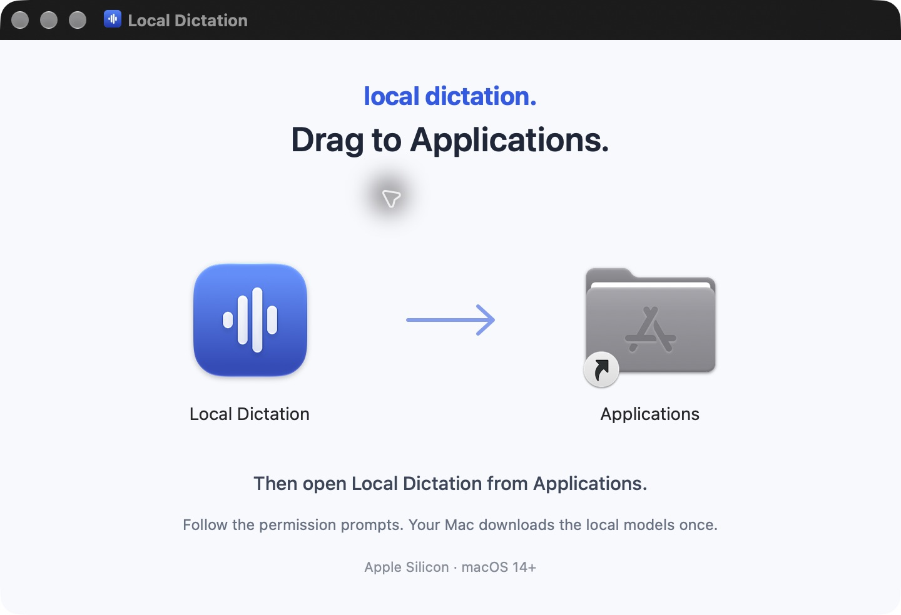

# Local Dictation 2.1.0 candidate

Status: local signed and notarized candidate, build 14. Not publicly released. The website and latest stable download remain v2.0.1. Fresh-Mac onboarding validation is still required.

## Guided first-run setup

Setup walks through one step at a time: welcome, privacy permissions, model preparation, shortcut selection and detection, practice dictation, and completion. Each permission is explained before macOS requests it. Setup advances only after the app confirms the actual grant.

Model downloads show transferred size, speed, and an estimated remaining time when available, with pause and resume. Existing caches are reused after integrity verification. Local inference still works offline once the models are ready.

Control-Shift-Space is offered as an optional shortcut. Setup verifies a real key press before practice; Fn / Globe and custom shortcuts remain available. Practice uses the real local pipeline and displays the result inside setup so a new user can try dictation before pasting into another app.

The DMG uses the familiar Mac installation flow: open the download, drag Local Dictation onto Applications, eject the image, and open the installed copy. A new original blue voice icon matches the website. The two-icon Finder layout includes Retina artwork and keeps extra opening guides hidden. Opening the disk-image copy shows placement guidance before any permission requests, shortcut registration, or model initialization.

For an update, finish any dictation and quit the old copy before choosing Replace in Finder. Existing external model caches and preferences remain available. A direct upgrade from v1.2 may need to download its previously bundled models again; keep the old bundle until setup is complete.

## Trusted Mac distribution

The app and both helpers use Developer ID signing, hardened runtime, and secure timestamps. The main app has the microphone entitlement. Apple accepted the app and disk image with no reported issues. Both notarization tickets are attached and pass Gatekeeper checks.

This candidate uses opening guidance for the notarized app. Microphone, Accessibility, and Input Monitoring approvals are still required. The initial transition from an older ad-hoc or creator self-signed build may require new approvals; retention across subsequent Developer ID updates has not yet been tested.

## Validation

- Setup state/permission/shortcut/practice regressions, native UI fixture renders, packaging checks, and resumable-notarization regressions passed.
- The signed Whisper helper initialized the cached speech model and Metal. The signed Ollama helper loaded cached Qwen and generated a synthetic local test response.
- Apple app submission: `8e1d49a4-a555-491f-ab2d-6d2fbe3596e8`.
- Apple DMG submission: `ddade107-4163-4f53-8808-aa163f59fc07`.
- The final DMG mounted successfully and its two-icon layout was checked in Finder at Retina resolution. The Applications shortcut points to /Applications. Extra guides are hidden and contain the matching drag instructions. A real copy into an isolated temporary Applications folder preserved the app signature and ticket; the copied app passed Gatekeeper.
- Final DMG: 13,608,696 bytes; SHA-256 `25f81f5cd9c90911edf21dee5b42f875658d5db2a83282c93782f7a8968bfd7b`. Manifest and checksum files describe the final signed and stapled bytes.

The creator's installed application is the earlier notarized 2.1.0 build 12; it was not interrupted or replaced by the icon and drag-installer checks. Fresh-Mac permission grants, first model download, practice, and external insertion remain unverified for this candidate. GitHub publication, remote asset digest verification, and the website download update have not occurred.
